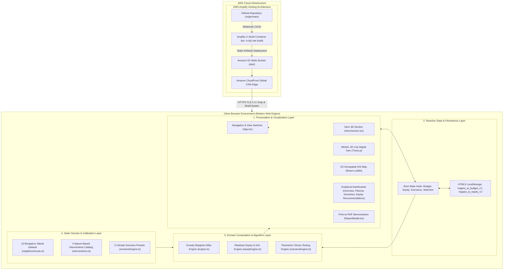
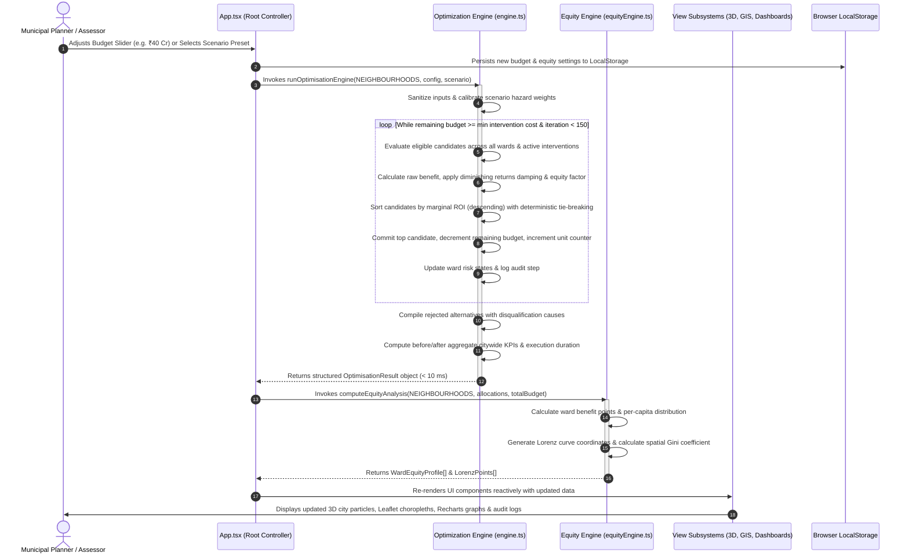
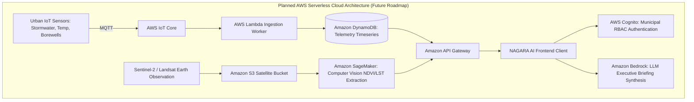

# High-Level Design Document (HLD)

## Project Name: NAGARA AI – Urban Sustainability Decision Engine
**Target Deployment:** AWS Amplify Hosting (Continuous Deployment from GitHub)  
**Repository:** Saai-Prithiiv07/nagara-ai  
**Document Version:** 1.0.0  
**Status:** Assessor Review Ready (Technical Project Viva)  

---

## 1. Introduction & Architectural Objectives

The **NAGARA AI Decision Engine** is an interactive, multi-dimensional urban sustainability modeling platform designed for municipal capital expenditure allocation and climate resilience stress-testing. 

### 1.1 Architectural Goals
1. **Ultra-Low Latency Edge Computation:** Execute complex combinatorial multi-attribute heuristic resource allocations client-side in under 10 milliseconds, eliminating round-trip network delays and cloud API cold-starts.
2. **Deterministic Reproducibility:** Guarantee that identical municipal budgets, equity weights, and climate scenario multipliers always produce identical allocation sequences and impact scores across all platforms.
3. **Decoupled Layered Design:** Maintain strict separation between visual rendering layers (3D WebGL, 2D Leaflet GIS, Recharts SVG) and mathematical domain logic (greedy marginal-utility optimization, Lorenz/Gini equity modeling, scenario parameterization).
4. **Resilient Operational Model:** Function reliably as a self-contained Single Page Application (SPA) delivered via Amazon CloudFront edge nodes, without maintaining stateful application servers or exposed database endpoints.

---

## 2. Actual Technology Stack Identification & Evaluation

| Layer | Selected Technology | Version | Architectural Rationale & Role |
| :--- | :--- | :--- | :--- |
| **Runtime & Core Framework** | **React** | `19.3.1` | Concurrent rendering architecture, fast reconciliation, and predictable component lifecycles for complex multi-view state. |
| **Type Safety & Contracts** | **TypeScript** | `~6.0.3` | Strong compile-time guarantees across domain models (neighbourhoods, interventions, allocation metrics, budget constraints). |
| **Build & Tooling** | **Vite** | `8.3.4` | High-performance ES module bundler providing instant Hot Module Replacement (HMR) and optimized tree-shaken static production builds. |
| **Styling & Design System** | **Tailwind CSS** | `4.3.3` | Utility-first CSS engine with glassmorphic dark-mode design system, CSS custom properties, and zero runtime overhead. |
| **3D Graphics & WebGL** | **Three.js** | `0.186.1` | WebGL canvas engine for procedural 3D digital twin city visualization, volumetric lighting, particle systems, and dynamic camera orbits. |
| **Geospatial & 2D GIS** | **Leaflet & React-Leaflet** | `1.9.4` / `5.0.0` | Lightweight vector tile and polygon rendering for ward boundaries, thematic choropleth overlays, and interactive map popups. |
| **Data Visualization** | **Recharts** | `3.10.1` | Declarative SVG charting library for dynamic comparative radar charts, capital expenditure bar charts, and Lorenz inequality curves. |
| **Micro-Animations** | **Framer Motion** | `14.6.0` | Hardware-accelerated UI transitions, tab swapping animations, modal overlays, and accessibility reduction controls. |
| **Unit Testing & Verification**| **Vitest** | `5.0.5` | Fast native Vite test runner executing 16 algorithmic verification suites in under 2 seconds. |
| **Code Quality & Linting** | **Oxlint** | `1.88.0` | High-speed Rust-based linter enforcing clean React patterns and zero unused references. |
| **Cloud Hosting & CDN** | **AWS Amplify Hosting** | Managed | Global static hosting, continuous deployment triggered on git commit, automated HTTPS certificate management, and Amazon CloudFront CDN edge caching. |

---

## 3. High-Level System Architecture Diagram



---

## 4. Architectural Subsystems

### 4.1 Subsystem 1: 3D WebGL Digital Twin Subsystem (`City3DCanvas.tsx`)
* **Role:** Delivers an immersive spatial visualization of Greater Bengaluru's urban core.
* **Architecture:**
  * Uses a dedicated Three.js `PerspectiveCamera` (FOV 45°) with animated target coordinates (`flyTo` interpolation toward focused wards).
  * Procedurally renders municipal building blocks, arterial roadways, and interactive 3D ward pin markers.
  * Supports 3 operational modes via dynamic material switching without WebGL context reconstruction:
    1. *Biophilic Mode:* Focuses on green canopy, living vegetation membranes, and ambient cooling mist.
    2. *Thermal Mode:* Highlights heat island concentrations with reddish-orange emissive shaders and rising thermal particle plumes.
    3. *Monsoon Mode:* Simulates dark convective cloudbursts, rain streaks, and stormwater runoff accumulation along street curbs.
  * Integrates `useReducedMotion` to automatically suspend camera orbits and particle loops when users prefer reduced motion.

### 4.2 Subsystem 2: 2D GIS Spatial Digital Twin Subsystem (`DigitalTwinMap.tsx`)
* **Role:** Provides accurate cartographic telemetry and multi-hazard choropleth visualization for Greater Bengaluru.
* **Architecture:**
  * Uses `react-leaflet` wrapping Leaflet v1.9, centered on Bengaluru coordinates `[12.9716, 77.5946]`.
  * Renders 10 municipal wards using explicit GeoJSON polygon boundaries (`[lat, lng]` coordinates).
  * Implements dynamic SVG polygon fill styling based on normalized 0–100 risk values (Composite Risk, Heat, Flood, Water, Green Cover).
  * Supports basemap toggling between CartoDB Dark Matter, OpenStreetMap, and Esri World Imagery (high-resolution satellite tiles).
  * Provides live search filtering by ward name, zone, or landmark, with animated map pan-and-zoom (`flyTo`).

### 4.3 Subsystem 3: Decision & Optimization Engine (`engine.ts`)
* **Role:** Solves the municipal capital allocation knapsack challenge using a greedy marginal-utility heuristic with diminishing returns.
* **Mathematical Core:**
  $$\rho(i, w) = \frac{S(i, w)}{\text{Cost}_{\text{unit}}(i)} = \frac{\left[ B_{\text{raw}}(i, w) \cdot \delta(k_{i, w}) \right] \cdot \Omega_{\text{equity}}(w, \alpha)}{\text{Cost}_{\text{unit}}(i)}$$
* **Constraints Enforced:**
  1. $\sum_{j} \text{Cost}_j \le \text{EffectiveBudget}$ (strict non-exceedance).
  2. $k_{i, w} < \text{MaxCapacity}(i)$ (physical spatial saturation per ward).
  3. $\text{Suitability}(i, w) \ge 0.15$ (topographical and density appropriateness threshold).
* **Tie-Breaking:** 3-tier deterministic sorting: Marginal ROI ($\rho$) $\rightarrow$ Equity-Adjusted Score ($S$) $\rightarrow$ Lexicographical Key (`wardId + interventionId`).

### 4.4 Subsystem 4: Equity & Spatial Justice Subsystem (`equityEngine.ts`)
* **Role:** Audits the social fairness of capital expenditure distributions.
* **Key Components:**
  * **Rawlsian Amplification:** Wards with high socio-economic vulnerability receive up to a $1.8\times$ priority multiplier when the user shifts the equity slider toward Rawlsian justice ($\alpha \rightarrow 1.0$).
  * **Lorenz Curve Computation:** Ranks wards by per-capita benefits and calculates cumulative population versus cumulative benefit curve coordinates.
  * **Spatial Gini Coefficient:** Computes citywide inequality index $G \in [0, 1]$ before and after intervention allocations.
  * **Status Categorization:** Labels each ward as *Heavily Prioritised*, *Equitably Funded*, or *Under-Allocated*.

### 4.5 Subsystem 5: Scenario Simulation Subsystem (`scenarioEngine.ts`)
* **Role:** Evaluates municipal intervention robustness under climate stress shocks and fiscal constraints.
* **Mechanisms:**
  * Maintains 5 scenario archetypes (Normal Baseline, Extreme Monsoon, Severe Drought, Heat Island Surge, Fiscal Austerity).
  * Modulates hazard weights dynamically: for example, extreme monsoons scale flood risk weight as $\tilde{w}_F = w_{F, 0} \cdot \gamma_{\text{rain}}^{1.4}$, prioritizing sponge drainage interventions automatically.

### 4.6 Subsystem 6: Reporting & Export Subsystem (`ReportModal.tsx`, `Recommendations.tsx`)
* **Role:** Generates auditable executive summaries for municipal committees and project assessors.
* **Outputs:**
  * Interactive 3-tier implementation schedules (Tier 1: Months 1–3, Tier 2: Months 4–8, Tier 3: Months 8–14).
  * Direct CSV dataset export for spreadsheet analysis.
  * CSS print-media optimized "Official Executive Decision Dossier" ready for one-click browser printing or PDF saving.

---

## 5. End-to-End Execution & Data Flow Pipeline



---

## 6. Cloud Hosting & Deployment Architecture (AWS Amplify)

### 6.1 AWS Amplify Hosting Topology

```mermaid
graph LR
    Dev[Developer / Git Client] -->|git push origin main| GH[GitHub: Saai-Prithiiv07/nagara-ai]
    
    subgraph AWS_Cloud ["Amazon Web Services (AWS)"]
        subgraph Amplify_Service ["AWS Amplify Hosting"]
            WH[Amplify Webhook Trigger]
            BuildRunner[Amplify CI/CD Runner: Node.js 20+ Environment]
            S3Storage[Amazon S3 Static Asset Bucket]
        end
        
        subgraph Edge_Delivery ["Global Edge Distribution"]
            CloudFront[Amazon CloudFront CDN Distribution]
            Route53[Amazon Route 53 / Amplify SSL Certificate]
        end
    end
    
    GH --> WH
    WH --> BuildRunner
    BuildRunner -->|1. npm ci\n2. npm run build (tsc -b && vite build)| S3Storage
    S3Storage --> CloudFront
    Route53 --> CloudFront
    CloudFront -->|High-Speed Static Delivery (Brotli/Gzip)| EndUser[Municipal Assessor / User Browser]
```

### 6.2 Build & Packaging Specifications
* **Build Command:** `tsc -b && vite build`
* **Output Artifact Directory:** `dist/`
* **Generated Assets:**
  * `index.html`: Entry HTML containing Leaflet CSS preloads, Inter/Space Grotesk typography headers.
  * `assets/index-[hash].js`: Minified, tree-shaken JavaScript bundle (~1.65 MB containing React, Three.js, Leaflet, and Recharts).
  * `assets/index-[hash].css`: Compiled Tailwind CSS v4 styling rules (~87 KB).
  * `public/favicon.svg`, `public/icons.svg`: Vector branding assets.
* **Edge Caching Policy:** Static immutable hashed assets cached at CloudFront edge nodes for 365 days; `index.html` configured with `no-cache` / `must-revalidate` for instant zero-downtime version rollouts.

---

## 7. Security, Privacy & Reliability Considerations

### 7.1 Security Architecture
* **Zero-Server Attack Surface:** Because the optimization engine and analytics execute exclusively in the browser runtime, there are no unauthenticated REST/GraphQL API endpoints, database ports, or backend servers susceptible to Denial-of-Service (DoS) or SQL injection.
* **Client-Side Cross-Site Scripting (XSS) Mitigation:** React’s declarative JSX automatically escapes dynamic string values rendered in the DOM, neutralizing DOM-based injection vulnerabilities.
* **No Secret Leaks:** The application does not store, bundle, or require private cloud access keys, AWS credentials, or secret API tokens in the client bundle.

### 7.2 Defensive Error Handling & Input Clamping
* **Input Sanitization:** As verified in automated test suite `15. handles invalid and undefined inputs safely`, all numeric parameters (budget, multipliers, weights) undergo explicit `Number.isNaN()` guards and range clamping (`Math.max(0, ...)`).
* **Safe Budget Depletion:** The greedy knapsack loop terminates safely if remaining funds fall below the cheapest available intervention (₹0.28 Cr for green roof retrofits) or if iteration count exceeds the 150-cycle safety ceiling.

---

## 8. Planned Architecture: Future Cloud Integrations

The current codebase is intentionally architected as a lightweight, zero-latency edge client. To support multi-city scaling and live sensor networks, the following AWS serverless architecture is planned:



---

## 9. Technical Viva Architecture Justifications

During technical project viva examination, the following design decisions highlight engineering maturity:

1. **Why Client-Side Greedy Knapsack instead of Server-Side Mixed Integer Linear Programming (MILP)?**
   * *Answer:* Urban CapEx decision-making in interactive workshops requires instantaneous sub-second feedback as stakeholders adjust budget and equity sliders. A client-side greedy heuristic with diminishing returns delivers sub-10ms response times, 100% determinism, and full algorithmic inspectability without server infrastructure costs or cold-start latency.
2. **Why Three.js alongside Leaflet GIS?**
   * *Answer:* Leaflet provides cartographic precision, accurate coordinate boundaries, and GIS choropleth analysis for 10 real Greater Bengaluru wards. Three.js complements this by offering an immersive, volumetric 3D representation that communicates micro-climate dynamics (convective heat plumes, cooling mists, rainfall streaks) in an intuitively compelling medium for executive stakeholders.
3. **How does the system ensure mathematical consistency?**
   * *Answer:* The engine guarantees $\sum \text{AllocatedCost} \le \text{EffectiveBudget}$ by evaluating the strict affordability of each discrete candidate prior to commitment, dynamically recalculating the remaining budget, and generating an automated audit trail of all transactions and rejected candidates.
