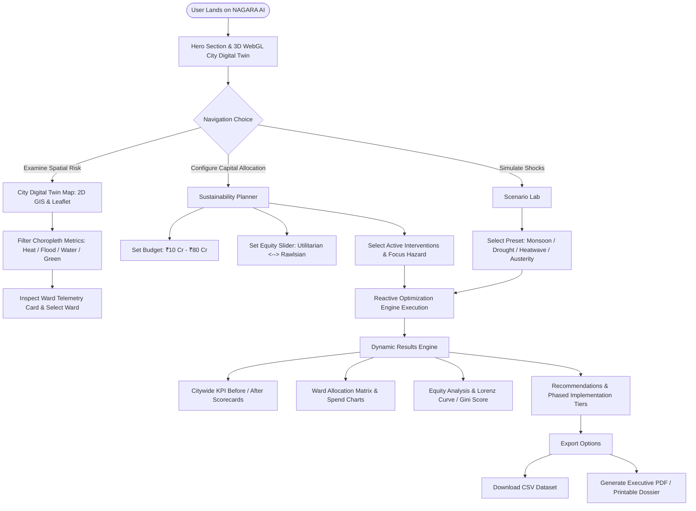

# Product Requirements Document (PRD)

## Project Name: NAGARA AI – Urban Sustainability Decision Engine
**Target Geography:** Greater Bengaluru Urban Agglomeration (BBMP / Modelled Wards)  
**Deployment Platform:** AWS Amplify Hosting  
**Repository:** Saai-Prithiiv07/nagara-ai  
**Document Version:** 1.0.0  
**Status:** Implemented & Assessor Review Ready (Viva Technical Dossier)  

---

## 1. Executive Summary

Rapid, unplanned urbanization across major global metropolises—exemplified by Greater Bengaluru—has triggered compound environmental and socio-ecological crises. Municipal authorities grapple simultaneously with expanding Urban Heat Islands (UHI), catastrophic monsoonal flash inundation, severe groundwater table depletion, and rapid erosion of urban tree canopies. These environmental risks disproportionately burden vulnerable socio-economic demographics in peripheral industrial corridors and high-density informal settlements.

Municipal capital expenditure (CapEx) planning has historically operated in bureaucratic silos: stormwater drainage, public parks, building retrofits, and rainwater harvesting initiatives are planned by disparate municipal bodies without integrated multi-hazard modeling, physical carry capacity verification, or rigorous equity auditing.

**NAGARA AI** is an algorithmic **Urban Sustainability Decision Engine** and interactive **3D/GIS Digital Twin** engineered to assist municipal urban planners, resilience commissioners, and civic stakeholders. By formulating public sustainability capital allocation as a **Multi-Attribute Greedy Marginal-Utility Knapsack Problem with Rawlsian Pareto-Equity Weighting**, NAGARA AI empowers decision-makers to simulate climate stress shocks, optimize resource allocation under strict budgetary ceilings, evaluate socio-spatial distribution fairness, and generate auditable executive capital roadmaps in real time.

---

## 2. Problem Statement & Civic Context

### 2.1 The Bengaluru Urban Poly-Crisis
1. **Urban Heat Islands (UHI):** Densely built industrial and commercial zones (such as Peenya Industrial Area and Shivajinagar) record localized surface temperatures up to 6–8°C higher than peripheral green zones, intensifying heat exhaustion risks for outdoor laborers.
2. **Flash Flooding & Valley Choking:** Infilling and encroachment of historical cascading lake valleys (e.g., Koramangala Valley and Bellandur Catchment) result in severe street inundation during short-duration, high-intensity convective cloudbursts.
3. **Aquifer Collapse & Water Stress:** Rapid peripheral expansion (such as Whitefield and Electronic City) has depleted shallow aquifers, driving private borewells past 1,400 feet and creating severe reliance on commercial water tankers.
4. **Socio-Spatial Disparity:** Capital investments historically cluster in high-revenue or politically vocal commercial corridors, leaving vulnerable low-income wards with critical deficits in protective green and civil infrastructure.

### 2.2 Core Decision Challenge
Municipal decision-makers must allocate a finite, constrained capital budget (e.g., ₹25 Crores to ₹80 Crores) across competing nature-based and civil interventions without exceeding physical ward carry capacities, while balancing utilitarian cost-efficiency against constitutional social justice and spatial equity.

---

## 3. Product Vision & Value Proposition

### 3.1 Vision
To deliver an open, deterministic, auditable, and mathematically grounded municipal decision-support system that translates complex urban climate risk indices into transparent, equitable, and actionable capital expenditure interventions.

### 3.2 Value Proposition
* **Deterministic Transparency:** Eliminates "black box" recommendations through inspectable mathematical formulations, diminishing marginal returns curves, and an open calculation audit log.
* **Scenario Resilience:** Enables ex-ante simulation of extreme climatic shocks (monsoon cloudbursts, severe droughts, heatwaves) and fiscal austerity cutbacks prior to capital commitment.
* **Spatial Equity by Design:** Incorporates a configurable Rawlsian maximin parameter to prevent geographic under-allocation in vulnerable communities.
* **Zero Cold-Start / Instant Edge Execution:** Engineered as a client-side reactive decision engine capable of recomputing citywide allocations in under 10 milliseconds without server dependencies.

---

## 4. User Personas & Stakeholders

| Persona | Role / Description | Primary Needs | Key Platform Touchpoints |
| :--- | :--- | :--- | :--- |
| **Chief Resilience Officer (CRO)** | Municipal executive responsible for citywide climate adaptation and risk mitigation. | High-level KPI dashboards, comparative hazard reduction radar charts, multi-hazard risk tracking. | Overview Dashboard, Executive Dossier / PDF Export |
| **Municipal CapEx Planner** | Urban engineer in charge of infrastructure budget allocation (BBMP / Urban Local Bodies). | Scenario stress-testing, budget sliders, intervention feasibility checks, cost-efficiency optimization. | Sustainability Planner, Scenario Lab |
| **Ward Committee & Civic Advocate** | Local community representatives advocating for underserved populations. | Proof of equitable capital distribution, vulnerability targeting, transparent rejection reasons for unfunded proposals. | Equity Analysis, Rejected Alternatives Panel |
| **Technical Project Assessor** | Academic / Technical Evaluator reviewing architecture, algorithms, and code quality. | Inspection of mathematical algorithms, type safety, test coverage, architectural patterns, and deployment reliability. | Vitest Suite, Algorithm Documentation, LLD & HLD Specs |

---

## 5. Scope & Feature Boundaries

### 5.1 Implemented Features (Current Codebase)
The following capabilities are fully implemented, verified via automated test suites, and deployed on AWS Amplify:

* **F-01: 3D Procedural Digital Twin City Canvas (WebGL / Three.js)**
  * Procedurally generated urban building geometry, street grids, and interactive ward spatial telemetry pins.
  * Three interactive diagnostic visualization modes: *Biophilic Urbanism*, *Thermal Heat Map*, and *Monsoon Drainage Stress*.
  * Particle simulation systems for atmospheric cooling mist, convective thermal plumes, and monsoonal rainfall.
  * Orbital and target-focused camera controllers with smooth transitions (`flyTo`).
  * Accessibility-compliant motion reduction (`useReducedMotion`).
* **F-02: 2D Interactive GIS Spatial Digital Twin (React-Leaflet)**
  * Spatial visualization of 10 real Greater Bengaluru municipal wards with exact polygon boundary coordinates.
  * Choropleth layer rendering supporting 5 diagnostic metrics: Composite Risk, Surface Heat Island, Flood Hazard, Aquifer Stress, and Tree Canopy Void.
  * Basemap switching: CartoDB Dark Matter, OpenStreetMap Standard, and Esri World Imagery (Satellite).
  * Real-time search query filtering and archetype categorization (Industrial, Valley, Tech Corridor, Heritage Core).
* **F-03: Multi-Attribute Greedy Marginal-Utility Optimization Engine**
  * Mathematical formulation allocating discrete units of 4 nature-based and civil interventions under strict budget knapsacks.
  * Diminishing marginal returns damping curve ($\delta(k) = \frac{1}{1 + 0.25k}$) preventing over-concentration in single wards.
  * Dynamic scenario-adjusted hazard weighting across Heat, Flood, Water, and Canopy.
  * 3-tier deterministic tie-breaking ensuring 100% reproducible outcomes across devices.
* **F-04: Rawlsian Equity & Spatial Justice Engine**
  * Parametric social vulnerability amplification multiplier ($\Omega_{\text{equity}}(w, \alpha)$).
  * Real-time Lorenz Curve calculation plotting cumulative population percentage against cumulative benefit percentage.
  * Citywide spatial Gini coefficient computation ($G \in [0, 1]$) with qualitative equity fairness rating.
  * Ward-level equity profile classification (*Heavily Prioritised*, *Equitably Funded*, *Under-Allocated*).
* **F-05: Dynamic Scenario Simulation Lab**
  * 5 one-click scenario presets: Normal Baseline, Extreme Monsoonal Cloudburst (+120% rain), Severe Drought (+85% water stress), Urban Heatwave (+45% thermal surge), and Fiscal Austerity (-40% budget).
  * Granular continuous adjustment sliders for rainfall, temperature, aquifer stress, and municipal budget multipliers.
* **F-06: Interactive Sustainability Planner & Budget Configurator**
  * Preset quick-budget triggers (₹10 Cr to ₹80 Cr) and fine-grained range slider controls.
  * Risk prioritization focus toggles (Balanced, Heat Island, Flood Runoff, Aquifer Recharge).
  * Live before-and-after KPI metric scorecards with percentage improvement indicators.
  * Interactive Recharts expenditure distribution breakdowns.
  * Transparent step-by-step calculation audit log feed.
  * Explainable "Rejected Alternatives" table detailing exact economic, capacity, or suitability disqualification reasons.
* **F-07: Actionable Recommendations & Phased Rollout Roadmap**
  * Algorithmic grouping into 3 execution phases: Tier 1 (Months 1–3 Mobilisation), Tier 2 (Months 4–8 Secondary Phase), Tier 3 (Months 8–14 Sustained Rollout).
  * Domain-specific engineering trade-off evaluations and maintenance requirements.
  * One-click CSV dataset export of calculated allocation schedules.
* **F-08: Executive Municipal Strategy Memorandum (Print-to-PDF Dossier)**
  * Modal-based executive briefing dossier styled for municipal review and desktop printing/saving as PDF.
  * Formatted tables, official reference IDs, date stamps, and signature authorizations.
* **F-09: Local Client Persistence & Automated Test Verification**
  * Client-side LocalStorage synchronization (`nagara_ai_budget_v1`, `nagara_ai_equity_v1`).
  * 16 automated Vitest unit tests verifying budget non-exceedance, deterministic stability, Gini formulas, and edge cases.

### 5.2 Planned Features (Future Roadmap / Out-of-Scope)
The following capabilities are intentionally identified as future enhancements:

* **P-01: Live IoT Sensor Telemetry Ingestion (AWS IoT Core & DynamoDB)**
  * Streaming real-time air quality (PM2.5/PM10), stormwater drainage level sensors, and borewell ultrasonic depth monitors.
* **P-02: Satellite Earth Observation Computer Vision (Sentinel / Landsat)**
  * Automated periodic calculation of Normalized Difference Vegetation Index (NDVI) and Land Surface Temperature (LST) rasters.
* **P-03: 2D St. Venant Hydraulic Hydrodynamic Flow Modeling**
  * Upstream-to-downstream topological routing across inter-connected lake cascades.
* **P-04: Role-Based Access Control (AWS Cognito RBAC)**
  * Distinct authorization profiles for Municipal Chief Engineers, Ward Councilors, and General Public viewers.
* **P-05: Generative AI Executive Narrative Synthesis (Amazon Bedrock / Claude)**
  * Natural language generation of ward-specific justification narratives for municipal gazette publication.

---

## 6. Functional Requirements (FR)

| ID | Requirement Name | Priority | Status | Description |
| :--- | :--- | :---: | :---: | :--- |
| **FR-01** | Ward Telemetry & Polygon Display | P0 | **Implemented** | Render 10 Greater Bengaluru municipal wards with boundary polygons, area, population, surface temperature, and composite baseline risks. |
| **FR-02** | 3D Digital Twin City Model | P1 | **Implemented** | Provide a WebGL 3D procedural representation of Bengaluru city blocks with Biophilic, Thermal, and Monsoon diagnostic visualization modes. |
| **FR-03** | Budget & Feasibility Knapsack Allocation | P0 | **Implemented** | Calculate greedy marginal utility allocations such that $\sum \text{Cost} \le \text{Budget}$ and physical unit capacities are strictly observed. |
| **FR-04** | Diminishing Marginal Returns Modeling | P0 | **Implemented** | Apply damping factor $\delta(k) = \frac{1}{1 + 0.25k}$ to successive units of identical interventions allocated to the same ward. |
| **FR-05** | Rawlsian Equity Parameterization | P0 | **Implemented** | Shift resource prioritization toward vulnerable populations based on user-controlled slider $\alpha \in [0, 1]$. |
| **FR-06** | Spatial Gini & Lorenz Computation | P0 | **Implemented** | Compute Lorenz curve data points and citywide Gini inequality coefficients ($G$) for pre- and post-intervention states. |
| **FR-07** | Climate Scenario Shock Testing | P1 | **Implemented** | Support 5 climate/economic presets and granular multiplier sliders dynamically altering hazard impact weighting. |
| **FR-08** | Explainable Decision Auditing | P0 | **Implemented** | Log every greedy selection cycle with exact marginal ROI rationale and maintain an inspectable list of rejected alternatives with disqualification causes. |
| **FR-09** | Phased Execution Scheduling | P1 | **Implemented** | Group allocations into 3 deployment tiers with timelines, engineering trade-offs, and CSV data export. |
| **FR-10** | Printable Executive Dossier | P1 | **Implemented** | Render a CSS print-optimized municipal memorandum for official project viva defense and administrative review. |
| **FR-11** | Dynamic Live IoT Data Feed | P3 | *Planned* | Ingest real-time weather and groundwater telemetry via AWS IoT Core and API Gateway. |
| **FR-12** | User Authentication & RBAC | P2 | *Planned* | Secure sensitive municipal CapEx parameters with AWS Cognito user pools. |

---

## 7. Non-Functional Requirements (NFR)

### 7.1 Performance & Latency
* **NFR-P1 (Optimization Execution Speed):** The greedy optimization algorithm must complete full multi-ward evaluation in under 25 milliseconds (benchmarked at ~2–8 ms in modern browsers).
* **NFR-P2 (3D Rendering Frame Rate):** The Three.js WebGL canvas must sustain a minimum of 45–60 FPS on standard modern hardware (Apple Silicon / Intel Iris / dedicated GPUs).
* **NFR-P3 (Initial Asset Load Time):** Production bundle served via AWS Amplify CDN must achieve First Contentful Paint (FCP) in under 1.8 seconds over standard broadband.

### 7.2 Determinism & Auditability
* **NFR-D1 (Algorithmic Determinism):** Given identical ward inputs, budget constraints, and scenario parameters, the engine must produce bit-for-bit identical allocation lists across different operating systems, browsers, and devices.
* **NFR-D2 (Budget Non-Exceedance Guarantee):** Total allocated expenditure must never exceed the active budget ceiling under any configuration ($\text{TotalAllocated} \le \text{Budget}_{\text{effective}}$).

### 7.3 Reliability & Browser Compatibility
* **NFR-R1 (Graceful Edge Degradation):** In environments where WebGL is unsupported or restricted, the 2D Leaflet GIS digital twin and analytical dashboards must remain fully functional.
* **NFR-R2 (Cross-Browser Support):** Fully verified on Chromium-based browsers (Chrome, Edge, Brave), Mozilla Firefox, and Apple Safari.

### 7.4 Security & Data Privacy
* **NFR-S1 (Client-Side Isolation):** All calculations occur entirely in client-side memory; no municipal operational parameters or user choices are transmitted to untrusted external logging servers.
* **NFR-S2 (Defensive Sanitization):** All budget numbers, scenario multipliers, and equity weights undergo strict clamping and boundary checks to prevent `NaN`, infinity, or negative expenditure leaks.

---

## 8. Domain Data Schema & Calibration

### 8.1 Modelled Municipal Wards (Bengaluru Archetypes)
The platform models 10 strategically chosen wards representing distinct urban morphological archetypes across Greater Bengaluru:

| Ward ID | Ward Name | Zone | Pop. | Area (km²) | Vulnerability | Primary Environmental Challenge |
| :--- | :--- | :--- | :---: | :---: | :---: | :--- |
| `ward-peenya` | Peenya Industrial Area | Dasarahalli | 185,000 | 14.2 | 82 / 100 | Severe Urban Heat Island (38.6°C surface temp), 7.2% tree canopy. |
| `ward-koramangala` | Koramangala Valley | South | 142,000 | 8.6 | 38 / 100 | Critical runoff sink, severe recurrent monsoon flash flooding (Risk: 89/100). |
| `ward-shivajinagar` | Shivajinagar Core | East | 168,000 | 5.4 | 86 / 100 | Dense historic core, high social vulnerability (86/100), low canopy (5.1%). |
| `ward-bellandur` | Bellandur Catchment | Mahadevapura | 210,000 | 19.8 | 44 / 100 | Lake basin urban runoff, severe storm surge and waterlogging. |
| `ward-whitefield` | Whitefield Corridor | Mahadevapura | 195,000 | 16.5 | 41 / 100 | Deep groundwater collapse (borewells >1,400 ft), heavy tanker reliance. |
| `ward-jayanagar` | Jayanagar Garden Suburb | South | 125,000 | 7.8 | 22 / 100 | Mature planned suburb, high canopy (34.2%), low relative vulnerability. |
| `ward-yelahanka` | Yelahanka Lake Basin | Yelahanka | 135,000 | 18.2 | 49 / 100 | Perched lake basin, vulnerable to monsoonal overflow. |
| `ward-krpuram` | K.R. Puram Transit Hub | K.R. Puram | 178,000 | 12.1 | 79 / 100 | Congested transport nexus, combined heat, runoff, and social vulnerability. |
| `ward-ecity` | Electronic City Cluster | Bommanahalli | 110,000 | 11.4 | 36 / 100 | Tech park enclave with severe peripheral water scarcity (Stress: 88/100). |
| `ward-malleshwaram` | Malleshwaram Zone | West | 132,000 | 6.2 | 31 / 100 | Mixed historic residential/commercial with moderate composite risks. |

### 8.2 Standardized Interventions Catalog
The platform evaluates 4 standardized municipal nature-based and civil interventions:

1. **Miyawaki Urban Pocket Forests (`urban-forest`)**
   * *Unit Cost:* ₹0.45 Cr (₹45 Lakhs per 0.5 hectare dense cluster of 1,200 native saplings).
   * *Impact:* -1.8°C localized heat reduction, +3.8% green canopy gain, 0.4 MLD water retention.
   * *Max Units/Ward:* 6.
2. **Cool & Biosolar Green Roof Retrofits (`green-roof`)**
   * *Unit Cost:* ₹0.28 Cr (₹28 Lakhs per 2,500 m² vegetative and high-albedo membrane).
   * *Impact:* -1.2°C localized heat reduction, -4.5% flood mitigation, 0.2 MLD water retention.
   * *Max Units/Ward:* 8.
3. **Ward Rainwater Harvesting & Recharge Wells (`rainwater-harvest`)**
   * *Unit Cost:* ₹0.35 Cr (₹35 Lakhs per 50 deep recharge injection wells with silt catchments).
   * *Impact:* +1.8 MLD aquifer recharge, -6.8% flood mitigation, -0.4°C localized cooling.
   * *Max Units/Ward:* 7.
4. **Bioswale & Sponge City Drainage Modernisation (`drainage-sponge`)**
   * *Unit Cost:* ₹0.65 Cr (₹65 Lakhs per 1.5 km bio-engineered vegetated channel).
   * *Impact:* -14.5% flood runoff mitigation, +1.1 MLD water recharge, +2.1% green cover.
   * *Max Units/Ward:* 5.

---

## 9. User Experience & Application Workflow

---

## 10. Success Criteria for Technical Viva

1. **Functional Integrity:** All 6 primary tabs (Overview, Map, Planner, Scenarios, Equity, Recommendations) and the modal dossier render without unhandled runtime exceptions.
2. **Mathematical Robustness:** The planner never breaches total CapEx budget ceilings ($\sum \text{AllocatedCost} \le \text{EffectiveBudget}$) and correctly prioritizes high-vulnerability wards when equity weight is increased.
3. **Automated Verification:** 100% of Vitest automated unit tests (16 test suites) execute cleanly and pass.
4. **Explainability Demonstration:** The presenter can articulate the exact reason why a candidate intervention was either selected or rejected for any specific ward in Greater Bengaluru.
5. **Deployment Accessibility:** Application is live, responsive, and performant on AWS Amplify hosting.
